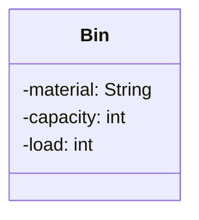
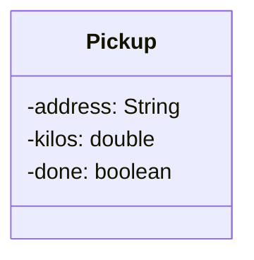

> [!info] AI-Generated

# A class as a box

A program of two or three classes fits in your head. A program of ten classes, each with its instance variables, constructors and methods, doesn't, and neither does a program that a team is about to write together. So programmers draw their classes: a box for each class, and lines between the boxes for how the classes are connected. Such a drawing is a **class diagram**.

Class diagrams have a standard form, part of **UML**, the Unified Modeling Language, so that a diagram drawn by one programmer can be read by anyone who knows UML. This module teaches you to read them, to turn them into classes, and to draw the classes you write.

## A box with fields

A recycling center has a bin for each material: glass, paper, metal and so on. Its program keeps each bin in an object of this class:

```java
public class Bin {
    private String material;
    private int capacity;
    private int load;
}
```

In a class diagram, the class is a box:



- The class's name is at the top, in bold.
- Under a line come the class's instance variables, one per line. Diagrams call them **fields** (or attributes).
- Each field is written as its name, a colon and its type: `capacity: int`. That's the other way around from Java, where the type comes first (`int capacity`).
- The sign in front is the field's **visibility**: `-` for `private` and `+` for `public`. Since this course keeps instance variables private, nearly every field you'll see starts with `-`. (You may also meet `#` for `protected`, from module 34.)

Under each drawing, "The diagram as text" says the same in words, which is handy when you want to check what a sign means.

A diagram is a plan, not a program: it doesn't run, and it may leave things out. This step's boxes show only fields. The next step adds constructors and methods.

## From a box to a class

A box tells you what to write. Here's the box of a pickup: a load that the center's truck collects from an address.



Each line becomes one instance variable, in the same order:

- `-address: String` is `private String address;`
- `-kilos: double` is `private double kilos;`
- `-done: boolean` is `private boolean done;`

With a constructor and a `toString`, which this box doesn't show, the class can be used:

**Main.java**

```java
public class Main {
    public static void main(String[] args) {
        Pickup pickup = new Pickup("12 Mill Road", 35.5);
        System.out.println(pickup);
    }
}
```

**Pickup.java**

```java
public class Pickup {
    private String address;
    private double kilos;
    private boolean done;

    public Pickup(String address, double kilos) {
        this.address = address;
        this.kilos = kilos;
        this.done = false;
    }

    @Override
    public String toString() {
        return this.address + ": " + this.kilos + " kg";
    }
}
```

**Output**

```text
12 Mill Road: 35.5 kg
```

The types in a box are Java's own: `int`, `double`, `boolean`, `String`, or `ArrayList<String>` for a field that holds a list of Strings. Write them exactly as the box says. A class with an `int` where its box says `double`, or a public field where the box says `-`, no longer matches the plan, and code that others wrote from the same plan may not work with it.

---

Source: [A class as a box](https://javaarena.com/learn/class-diagrams/boxes/) in the module [Class diagrams](https://javaarena.com/learn/class-diagrams/) on Java Arena.

This module follows section [11.1 Class diagrams](https://java-programming.mooc.fi/part-11/1-class-diagrams) of [Java Programming](https://java-programming.mooc.fi) by Arto Hellas, Matti Luukkainen and contributors (Agile Education Research group, University of Helsinki), licensed under [CC BY-NC-SA 4.0](https://creativecommons.org/licenses/by-nc-sa/4.0/). The explanations and exercises here are written for Java Arena and shared under the same license. Java Arena is not affiliated with or endorsed by the University of Helsinki.
