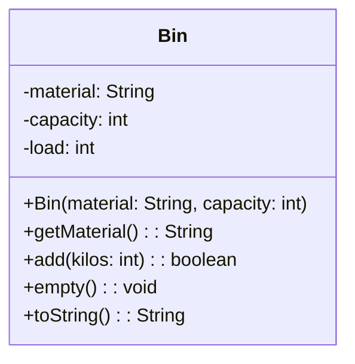

> [!info] AI-Generated

# Constructors and methods in a box

A box has room for more than fields. Under a second line come the class's constructors and methods. Here's the recycling center's bin with them:



- A **constructor** is the class's name with its parameters in parentheses, and nothing after them: a constructor has no return type, in a diagram as in Java.
- A **method** is its name, its parameters in parentheses, a colon and its **return type**: `getMaterial(): String` returns a String. A method that returns nothing has `void`.
- Each **parameter** is written like a field, name first: `add(kilos: int)` takes an int called `kilos`. Parameters are separated by commas, and a method without parameters has empty parentheses.
- The sign in front is the visibility again. Constructors and methods that other classes call are public, `+`. A private helper method gets a `-`.
- Constructors come first, then methods.

So each line gives you a header:

| In the box | In Java |
|---|---|
| `+Bin(material: String, capacity: int)` | `public Bin(String material, int capacity)` |
| `+getMaterial(): String` | `public String getMaterial()` |
| `+add(kilos: int): boolean` | `public boolean add(int kilos)` |
| `+empty(): void` | `public void empty()` |

`toString` is one of Bin's methods, so it has a line too. `@Override` isn't shown: a box shows headers, and nothing above them or inside them.

## What a box doesn't say

The box gives every header, but not what the methods do. Does `add` refuse a load that doesn't fit? What does `toString` return? A diagram leaves that to the code, or, before the code exists, to words. The team that drew this box agreed that a new bin is empty, that `add` puts the load in and returns `true` only if the bin's load stays within its capacity (otherwise it changes nothing and returns `false`), and that `empty` sets the load back to 0. With those words and the box, the class almost writes itself:

**Main.java**

```java
public class Main {
    public static void main(String[] args) {
        Bin glass = new Bin("glass", 500);
        System.out.println(glass.add(300));
        System.out.println(glass.add(250));
        System.out.println(glass);
        glass.empty();
        System.out.println(glass.add(250) + " " + glass.getMaterial());
    }
}
```

**Bin.java**

```java
public class Bin {
    private String material;
    private int capacity;
    private int load;

    public Bin(String material, int capacity) {
        this.material = material;
        this.capacity = capacity;
        this.load = 0;
    }

    public String getMaterial() {
        return this.material;
    }

    public boolean add(int kilos) {
        if (this.load + kilos > this.capacity) {
            return false;
        }
        this.load += kilos;
        return true;
    }

    public void empty() {
        this.load = 0;
    }

    @Override
    public String toString() {
        return this.material + ": " + this.load + "/" + this.capacity + " kg";
    }
}
```

**Output**

```text
true
false
glass: 300/500 kg
true glass
```

The challenges in this module work the same way: a box, and words that say what the methods do. Follow the box's headers exactly. Other classes call the methods by those names, with those types, and a header that's different can make their calls fail to compile, or quietly change what they compute.

---

Source: [Constructors and methods in a box](https://javaarena.com/learn/class-diagrams/methods/) in the module [Class diagrams](https://javaarena.com/learn/class-diagrams/) on Java Arena.

This module follows section [11.1 Class diagrams](https://java-programming.mooc.fi/part-11/1-class-diagrams) of [Java Programming](https://java-programming.mooc.fi) by Arto Hellas, Matti Luukkainen and contributors (Agile Education Research group, University of Helsinki), licensed under [CC BY-NC-SA 4.0](https://creativecommons.org/licenses/by-nc-sa/4.0/). The explanations and exercises here are written for Java Arena and shared under the same license. Java Arena is not affiliated with or endorsed by the University of Helsinki.
