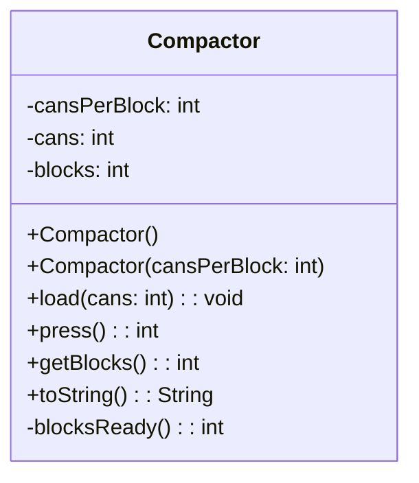

> [!info] AI-Generated

# From code to a box

The last two steps went from a box to code. The other way is just as useful: when you join a project, or come back to your own program after a month, a box shows a class at a glance, without the method bodies in the way.

## Drawing a class's box

Here's another class of the recycling center's program. A compactor presses cans into blocks: it takes loads of cans, and each time it runs, it presses as many full blocks as it can and keeps the rest of the cans for the next run.

**Main.java**

```java
public class Main {
    public static void main(String[] args) {
        Compactor compactor = new Compactor(50);
        compactor.load(120);
        System.out.println(compactor.press());
        compactor.load(35);
        System.out.println(compactor.press());
        System.out.println(compactor);
    }
}
```

**Compactor.java**

```java
public class Compactor {
    private int cansPerBlock;
    private int cans;
    private int blocks;

    public Compactor() {
        this(50);
    }

    public Compactor(int cansPerBlock) {
        this.cansPerBlock = cansPerBlock;
        this.cans = 0;
        this.blocks = 0;
    }

    public void load(int cans) {
        if (cans > 0) {
            this.cans += cans;
        }
    }

    public int press() {
        int made = this.blocksReady();
        this.blocks += made;
        this.cans -= made * this.cansPerBlock;
        return made;
    }

    public int getBlocks() {
        return this.blocks;
    }

    @Override
    public String toString() {
        return this.blocks + " blocks, " + this.cans + " cans waiting";
    }

    private int blocksReady() {
        return this.cans / this.cansPerBlock;
    }
}
```

**Output**

```text
2
1
3 blocks, 5 cans waiting
```

Go through the class from the top, and write a line for each part of it:



- Each instance variable is a field line: sign, name, colon, type. The values it gets at the start (`this.cans = 0`) aren't shown.
- Each constructor has a line of its own, so the two constructors are two lines. The one without parameters has empty parentheses.
- Each method has a line: `public int press()` becomes `+press(): int`. `toString` is one of the class's methods, so it's there too.
- The private helper `blocksReady` gets a `-`.
- Nothing between the curly braces of a constructor or method is shown: no code, no `this`, no `if`. Neither is `@Override`.
- This course's diagrams show the classes that the program makes objects of, and leave `Main` out.

## What a box doesn't tell

From the box, you know that `press()` returns an int. You don't know what the int means: the blocks it made, the cans it pressed, or the cans left over. You don't know that 50 cans make a block unless someone tells you, or that `load` ignores a negative number. Two classes with the same box can behave in completely different ways. A box shows a class's structure: what its objects hold and what they can be asked. What they do is in the code, and in the words that come with a diagram.

## Using a class through its box

A box is still all you need to write code that *uses* the class, once you know what its methods do. It gives each method's name, what to pass it and what comes back, so it tells you what type of variable can hold each answer:

```java
Compactor compactor = new Compactor();
compactor.load(80);
int made = compactor.press();
int total = compactor.getBlocks();
```

- `+Compactor()` says that `new Compactor()` works without parameters.
- `+load(cans: int): void` takes an int and gives nothing back, so the call is a statement of its own.
- `+press(): int` gives back an int, which can go into an `int` variable.
- `-blocksReady(): int` is private, so this code can't call it. Only Compactor's own methods can.

---

Source: [From code to a box](https://javaarena.com/learn/class-diagrams/from-code/) in the module [Class diagrams](https://javaarena.com/learn/class-diagrams/) on Java Arena.

This module follows section [11.1 Class diagrams](https://java-programming.mooc.fi/part-11/1-class-diagrams) of [Java Programming](https://java-programming.mooc.fi) by Arto Hellas, Matti Luukkainen and contributors (Agile Education Research group, University of Helsinki), licensed under [CC BY-NC-SA 4.0](https://creativecommons.org/licenses/by-nc-sa/4.0/). The explanations and exercises here are written for Java Arena and shared under the same license. Java Arena is not affiliated with or endorsed by the University of Helsinki.
