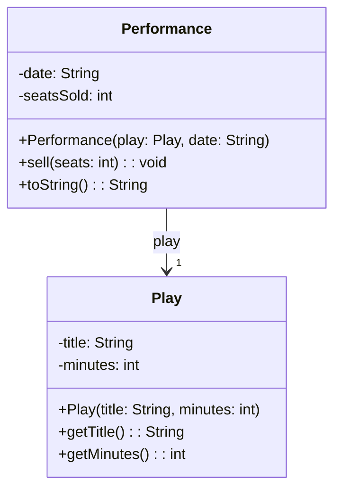
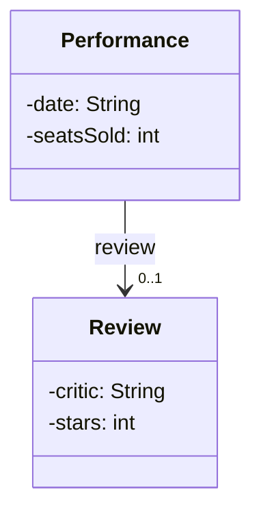

> [!info] AI-Generated

# Arrows between classes

So far each box stood alone. In a program, objects hold references to other objects, and a class diagram shows that with lines between the boxes.

## A field that refers to another class

A theater stages plays, and each play gets many performances. The program has a class for each, and a Performance holds a reference to its Play:

```java
public class Performance {
    private Play play;
    private String date;
    private int seatsSold;

    // the constructor and methods
}
```

In a diagram, a field whose type is another class of the diagram isn't written in the box. It's drawn as an arrow, from the box of the class that has the field to the box of the class it refers to:



- The arrow goes **from** Performance **to** Play: a Performance knows its Play. It has a field of type Play, so its methods can call the play's methods.
- A Play doesn't know its performances. It has no field for them, and the arrow doesn't point back: given a Play object, there's no way to reach its performances.
- The `1` at the arrowhead is the **multiplicity**: each Performance has exactly one Play. An arrow without a number at its head means one, too.
- The name by the arrow, `play`, is the field's name. It's optional, and handy when a class has two fields of the same type.
- `play: Play` in the constructor is a parameter, so it stays in the box. Only the field turns into an arrow.
- `date: String` stays in the box, though String is a class too. Arrows connect the program's own classes, the ones drawn in the diagram. Java's classes, such as String and ArrayList, are written as types.

Here's the code:

**Main.java**

```java
public class Main {
    public static void main(String[] args) {
        Play hamlet = new Play("Hamlet", 190);
        Performance friday = new Performance(hamlet, "May 9");
        Performance saturday = new Performance(hamlet, "May 10");
        friday.sell(120);
        saturday.sell(95);
        friday.sell(30);
        System.out.println(friday);
        System.out.println(saturday);
    }
}
```

**Play.java**

```java
public class Play {
    private String title;
    private int minutes;

    public Play(String title, int minutes) {
        this.title = title;
        this.minutes = minutes;
    }

    public String getTitle() {
        return this.title;
    }

    public int getMinutes() {
        return this.minutes;
    }
}
```

**Performance.java**

```java
public class Performance {
    private Play play;
    private String date;
    private int seatsSold;

    public Performance(Play play, String date) {
        this.play = play;
        this.date = date;
        this.seatsSold = 0;
    }

    public void sell(int seats) {
        this.seatsSold += seats;
    }

    @Override
    public String toString() {
        return this.play.getTitle() + " (" + this.play.getMinutes() + " min), " + this.date + ": " + this.seatsSold + " seats sold";
    }
}
```

**Output**

```text
Hamlet (190 min), May 9: 150 seats sold
Hamlet (190 min), May 10: 95 seats sold
```

Both performances refer to the same Play object. "Each Performance has one Play" says how many plays a performance has, not that their plays are different objects: many performances can share one play, as `friday` and `saturday` do.

## One, or none

A reference can also be `null`. A multiplicity of `0..1` at the arrowhead means at most one: zero or one. Say a critic may review a performance, or not:



Performance's field `review` is `null` until a review comes in, so code that uses it has to check for `null` first. With `1`, the code can count on the field always referring to an object.

---

Source: [Arrows between classes](https://javaarena.com/learn/class-diagrams/connections/) in the module [Class diagrams](https://javaarena.com/learn/class-diagrams/) on Java Arena.

This module follows section [11.1 Class diagrams](https://java-programming.mooc.fi/part-11/1-class-diagrams) of [Java Programming](https://java-programming.mooc.fi) by Arto Hellas, Matti Luukkainen and contributors (Agile Education Research group, University of Helsinki), licensed under [CC BY-NC-SA 4.0](https://creativecommons.org/licenses/by-nc-sa/4.0/). The explanations and exercises here are written for Java Arena and shared under the same license. Java Arena is not affiliated with or endorsed by the University of Helsinki.
