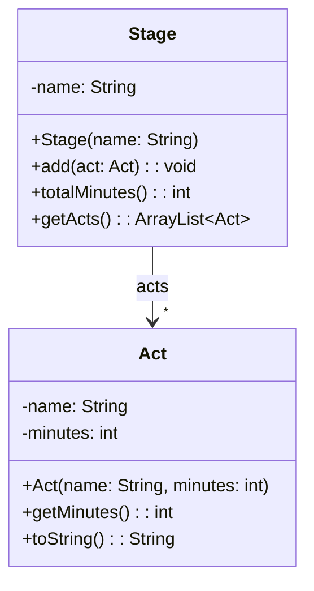
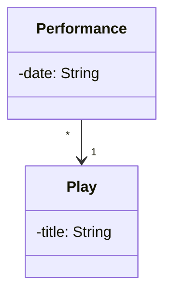
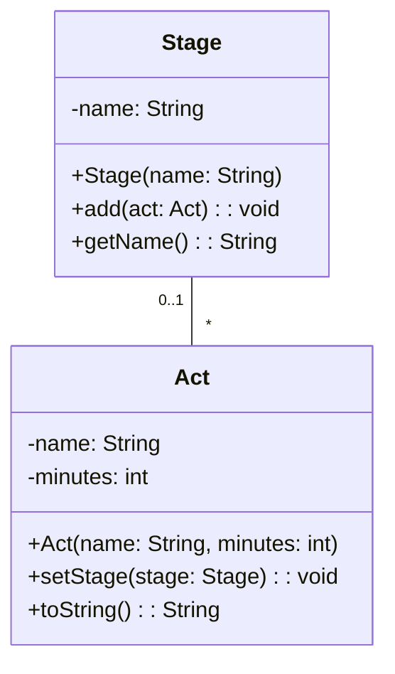

> [!info] AI-Generated

# Many objects, and arrows both ways

## A star for a list

At a music festival, each stage has a lineup of acts. `Stage` keeps them in a list:

```java
public class Stage {
    private String name;
    private ArrayList<Act> acts;

    // the constructor and methods
}
```

The list holds Act objects, so it's drawn as an arrow to Act, like a field of type Act would be. A star at the arrowhead says that a Stage has any number of them:



- `*` means any number, zero included: a new stage has an empty lineup.
- The list isn't in Stage's box, just as a single Act field wouldn't be. The arrow and its star stand for `private ArrayList<Act> acts;`, which the constructor creates.
- The methods that work with the list are in the box as usual. A list type is written as in Java: `getActs(): ArrayList<Act>`.
- Other multiplicities you may meet: `1..*` for one or more, and a range such as `2..4`.
- A list of Strings or of numbers stays in the box as a field, such as `-tags: ArrayList<String>`. Arrows are for the diagram's own classes.

**Main.java**

```java
public class Main {
    public static void main(String[] args) {
        Stage tent = new Stage("Blue Tent");
        tent.add(new Act("The Low Tides", 45));
        tent.add(new Act("Mira Solen", 30));
        System.out.println(tent.getActs());
        System.out.println(tent.totalMinutes());
    }
}
```

**Act.java**

```java
public class Act {
    private String name;
    private int minutes;

    public Act(String name, int minutes) {
        this.name = name;
        this.minutes = minutes;
    }

    public int getMinutes() {
        return this.minutes;
    }

    @Override
    public String toString() {
        return this.name + " (" + this.minutes + " min)";
    }
}
```

**Stage.java**

```java
import java.util.ArrayList;

public class Stage {
    private String name;
    private ArrayList<Act> acts;

    public Stage(String name) {
        this.name = name;
        this.acts = new ArrayList<>();
    }

    public void add(Act act) {
        this.acts.add(act);
    }

    public int totalMinutes() {
        int total = 0;
        for (Act act : this.acts) {
            total += act.getMinutes();
        }
        return total;
    }

    public ArrayList<Act> getActs() {
        return this.acts;
    }
}
```

**Output**

```text
[The Low Tides (45 min), Mira Solen (30 min)]
75
```

You'll also see the list created right where the field is declared, instead of in the constructor:

```java
public class Stage {
    private String name;
    private ArrayList<Act> acts = new ArrayList<>();

    public Stage(String name) {
        this.name = name;
    }

    // the methods as before
}
```

It does the same thing: each new Stage gets an empty list of its own, and the diagram is the same. Any instance variable can get its first value this way, for example an array: `private int[] scores = new int[5];`.

A multiplicity can also sit at the start of an arrow. It then says how many objects of the first class can share one object at the head. Step 4's performances, drawn with both numbers:



Each Performance has one Play, and a Play can have any number of performances, even though a Play doesn't know them: the arrow still points one way.

## Both ways

The acts above don't know which stage they're on. If the program needs that, say to print each act with its stage, Act gets a field of type Stage, and then the two classes know each other. The diagram draws that as a line **without an arrowhead**, with a multiplicity at each end:



Read each end's number as "how many of these": each Stage has any number of Acts (the `*` at Act's end), and each Act is on at most one Stage (the `0..1` at Stage's end: none until it's added).

In code, a connection both ways is two fields: Stage's list of acts, and Act's `stage`. They have to agree: when an act goes on a stage, the act must learn its stage too. The usual way is to let one method do both. Inside a method, `this` is the object the method was called on, so `act.setStage(this)` gives the act this very stage:

**Main.java**

```java
public class Main {
    public static void main(String[] args) {
        Stage tent = new Stage("Blue Tent");
        Act tides = new Act("The Low Tides", 45);
        System.out.println(tides);
        tent.add(tides);
        System.out.println(tides);
    }
}
```

**Stage.java**

```java
import java.util.ArrayList;

public class Stage {
    private String name;
    private ArrayList<Act> acts;

    public Stage(String name) {
        this.name = name;
        this.acts = new ArrayList<>();
    }

    public void add(Act act) {
        this.acts.add(act);
        act.setStage(this);
    }

    public String getName() {
        return this.name;
    }
}
```

**Act.java**

```java
public class Act {
    private String name;
    private int minutes;
    private Stage stage;

    public Act(String name, int minutes) {
        this.name = name;
        this.minutes = minutes;
        this.stage = null;
    }

    public void setStage(Stage stage) {
        this.stage = stage;
    }

    @Override
    public String toString() {
        if (this.stage == null) {
            return this.name + ", " + this.minutes + " min, no stage yet";
        }
        return this.name + ", " + this.minutes + " min, " + this.stage.getName();
    }
}
```

**Output**

```text
The Low Tides, 45 min, no stage yet
The Low Tides, 45 min, Blue Tent
```

A connection both ways costs more than an arrow: two fields to keep in step, and a change that updates one side and forgets the other leaves them disagreeing. So draw, and write, a one-way arrow unless the program really needs both directions.

---

Source: [Many objects, and arrows both ways](https://javaarena.com/learn/class-diagrams/many/) in the module [Class diagrams](https://javaarena.com/learn/class-diagrams/) on Java Arena.

This module follows section [11.1 Class diagrams](https://java-programming.mooc.fi/part-11/1-class-diagrams) of [Java Programming](https://java-programming.mooc.fi) by Arto Hellas, Matti Luukkainen and contributors (Agile Education Research group, University of Helsinki), licensed under [CC BY-NC-SA 4.0](https://creativecommons.org/licenses/by-nc-sa/4.0/). The explanations and exercises here are written for Java Arena and shared under the same license. Java Arena is not affiliated with or endorsed by the University of Helsinki.
