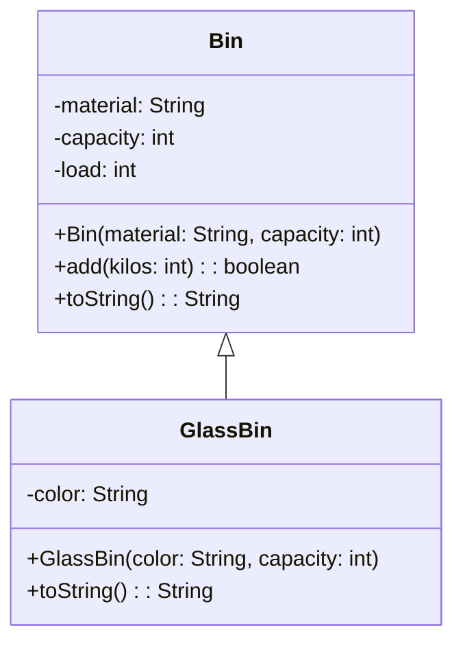
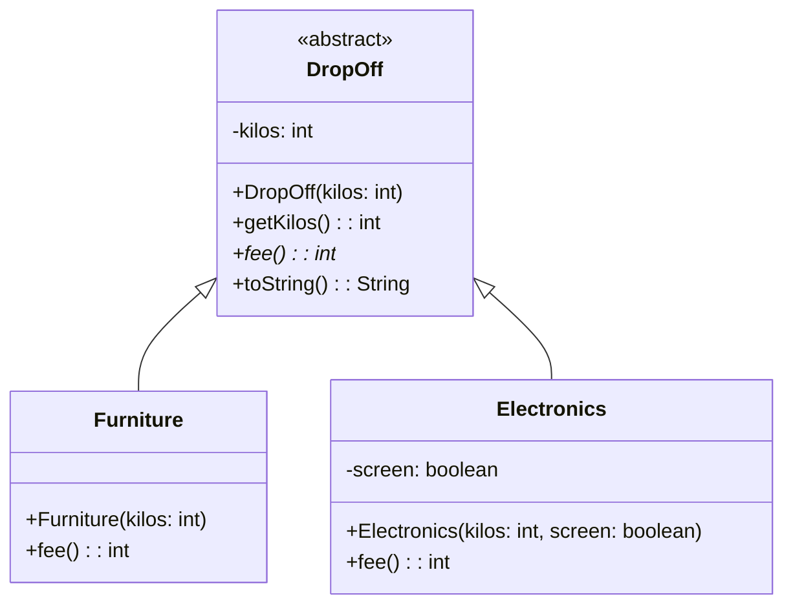

> [!info] AI-Generated

# Inheritance and abstract classes

## A triangle points to the parent

Inheritance (module 34) has a line of its own in a class diagram. The recycling center's glass bins are sorted by color, so a `GlassBin` extends `Bin` with a color:



- The subclass's box is below its parent's, joined to it by a line with a **hollow triangle** at the parent's end. The triangle points to the class that is extended: GlassBin extends Bin.
- The subclass's box shows only what GlassBin itself writes: its own field, its constructor, and the `toString` it overrides. It inherits `add`, but `add` is drawn once, in Bin's box.
- Bin's private fields aren't repeated in GlassBin's box either. They're declared in Bin, even though every GlassBin object has them.

**Main.java**

```java
public class Main {
    public static void main(String[] args) {
        GlassBin green = new GlassBin("green", 400);
        green.add(120);
        System.out.println(green);
    }
}
```

**Bin.java**

```java
public class Bin {
    private String material;
    private int capacity;
    private int load;

    public Bin(String material, int capacity) {
        this.material = material;
        this.capacity = capacity;
        this.load = 0;
    }

    public boolean add(int kilos) {
        if (this.load + kilos > this.capacity) {
            return false;
        }
        this.load += kilos;
        return true;
    }

    @Override
    public String toString() {
        return this.material + ": " + this.load + "/" + this.capacity + " kg";
    }
}
```

**GlassBin.java**

```java
public class GlassBin extends Bin {
    private String color;

    public GlassBin(String color, int capacity) {
        super("glass", capacity);
        this.color = color;
    }

    @Override
    public String toString() {
        return this.color + " " + super.toString();
    }
}
```

**Output**

```text
green glass: 120/400 kg
```

When several classes extend one parent, the children sit side by side under it, and their lines meet at the parent's one triangle.

## Abstract classes

An abstract class (module 34) is drawn like any other class, with two marks: «abstract» above its name, which is in italics, and its abstract methods in italics too.

People also bring the recycling center things that don't go in a bin, and pay a fee that depends on what they bring:



- DropOff's name is in italics under «abstract»: there are no objects of DropOff itself, only Furniture and Electronics objects.
- `fee()` is in italics in DropOff's box: it's abstract there, a header without a body. Each subclass writes it, so it's in their boxes again, in plain letters.
- A subclass can have no fields of its own, like Furniture, whose field part is empty.

**Main.java**

```java
import java.util.ArrayList;

public class Main {
    public static void main(String[] args) {
        ArrayList<DropOff> today = new ArrayList<>();
        today.add(new Furniture(30));
        today.add(new Electronics(8, true));
        today.add(new Electronics(2, false));
        int total = 0;
        for (DropOff item : today) {
            System.out.println(item);
            total += item.fee();
        }
        System.out.println("Total " + total);
    }
}
```

**DropOff.java**

```java
public abstract class DropOff {
    private int kilos;

    public DropOff(int kilos) {
        this.kilos = kilos;
    }

    public int getKilos() {
        return this.kilos;
    }

    public abstract int fee();

    @Override
    public String toString() {
        return this.kilos + " kg, fee " + this.fee();
    }
}
```

**Furniture.java**

```java
public class Furniture extends DropOff {
    public Furniture(int kilos) {
        super(kilos);
    }

    @Override
    public int fee() {
        return 2 * this.getKilos();
    }
}
```

**Electronics.java**

```java
public class Electronics extends DropOff {
    private boolean screen;

    public Electronics(int kilos, boolean screen) {
        super(kilos);
        this.screen = screen;
    }

    @Override
    public int fee() {
        if (this.screen) {
            return 20;
        }
        return 5;
    }
}
```

**Output**

```text
30 kg, fee 60
8 kg, fee 20
2 kg, fee 5
Total 85
```

---

Source: [Inheritance and abstract classes](https://javaarena.com/learn/class-diagrams/inheritance/) in the module [Class diagrams](https://javaarena.com/learn/class-diagrams/) on Java Arena.

This module follows section [11.1 Class diagrams](https://java-programming.mooc.fi/part-11/1-class-diagrams) of [Java Programming](https://java-programming.mooc.fi) by Arto Hellas, Matti Luukkainen and contributors (Agile Education Research group, University of Helsinki), licensed under [CC BY-NC-SA 4.0](https://creativecommons.org/licenses/by-nc-sa/4.0/). The explanations and exercises here are written for Java Arena and shared under the same license. Java Arena is not affiliated with or endorsed by the University of Helsinki.
