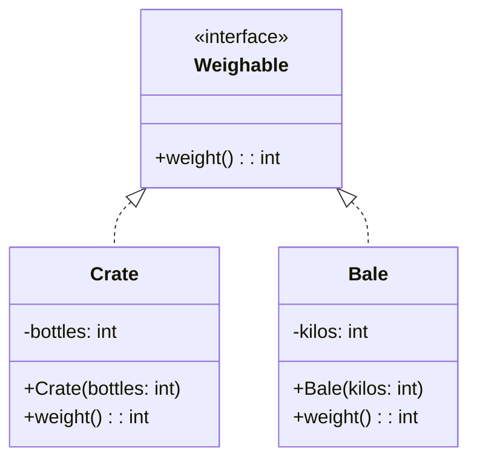
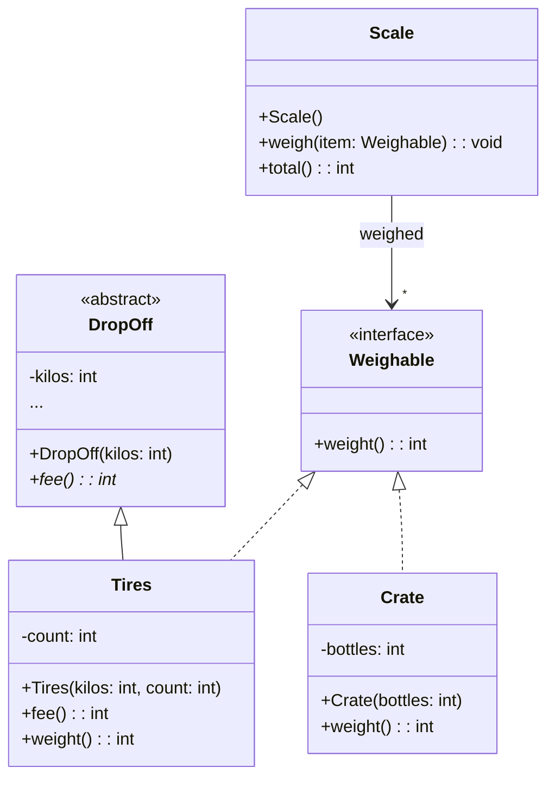

> [!info] AI-Generated

# Interfaces, and a whole program

## An interface's box

An interface (module 35) gets a box like a class, with «interface» above its name. It has no instance variables and no constructor, so below its name, its box lists only the methods.

The recycling center's weighing station weighs anything that can say what it weighs, so it has an interface `Weighable`. A crate of bottles and a bale of paper both implement it:



- The interface's methods are public, `+`. The interface only lists them, so a line for each is all there is to show.
- A class that implements the interface is joined to it by a **dashed** line with a hollow triangle at the interface: the triangle of `extends`, dashed for `implements`.
- Each class's box lists the interface's methods again, since each class writes them.
- A class that implements several interfaces has a dashed line to each of them.

**Main.java**

```java
import java.util.ArrayList;

public class Main {
    public static void main(String[] args) {
        ArrayList<Weighable> station = new ArrayList<>();
        station.add(new Crate(24));
        station.add(new Bale(250));
        int total = 0;
        for (Weighable item : station) {
            total += item.weight();
        }
        System.out.println(total + " kg");
    }
}
```

**Weighable.java**

```java
public interface Weighable {
    int weight();
}
```

**Crate.java**

```java
public class Crate implements Weighable {
    private int bottles;

    public Crate(int bottles) {
        this.bottles = bottles;
    }

    @Override
    public int weight() {
        return 2 + this.bottles / 2;
    }
}
```

**Bale.java**

```java
public class Bale implements Weighable {
    private int kilos;

    public Bale(int kilos) {
        this.kilos = kilos;
    }

    @Override
    public int weight() {
        return this.kilos;
    }
}
```

**Output**

```text
264 kg
```

## A whole program

A diagram of a whole program uses everything at once. Here's the weighing station with a `Scale` that remembers what it has weighed, and old tires, from step 6, that can be weighed as well:



To read a diagram like this, go through it in layers:

1. **The boxes.** What each one is: a class, an abstract class («abstract») or an interface («interface»).
2. **The triangles.** Each solid one is an `extends`, each dashed one an `implements`. Tires does both: it extends DropOff and implements Weighable.
3. **The arrows.** Each is a field, and a star makes it a list. The Scale keeps a list of Weighables: it can weigh crates and tires alike, and any class that implements Weighable later.
4. **The members**, box by box. A line `...` stands for members that the diagram leaves out, as in DropOff's box: step 6 showed the rest.

To write the program, start with what needs no other class of the diagram: here the interface and DropOff. Then write the classes that extend or implement them, Tires and Crate, and last the classes whose arrows point at the others, the Scale. Each file then compiles as soon as it's written, since everything it names is already there.

---

Source: [Interfaces, and a whole program](https://javaarena.com/learn/class-diagrams/interfaces/) in the module [Class diagrams](https://javaarena.com/learn/class-diagrams/) on Java Arena.

This module follows section [11.1 Class diagrams](https://java-programming.mooc.fi/part-11/1-class-diagrams) of [Java Programming](https://java-programming.mooc.fi) by Arto Hellas, Matti Luukkainen and contributors (Agile Education Research group, University of Helsinki), licensed under [CC BY-NC-SA 4.0](https://creativecommons.org/licenses/by-nc-sa/4.0/). The explanations and exercises here are written for Java Arena and shared under the same license. Java Arena is not affiliated with or endorsed by the University of Helsinki.
