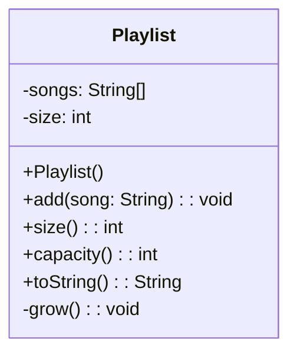

> [!info] AI-Generated

# A list of your own

Step 1 kept an array, a count and the copying in `main`. A list keeps all three inside an object, and the code that uses it only calls `add`. Here's a Playlist class that keeps song titles that way:

**Main.java**

```java
public class Main {
    public static void main(String[] args) {
        Playlist playlist = new Playlist();
        String[] songs = {"Morning Rain", "Night Train", "Paper Boats", "Slow River", "Copper Sky", "Lantern Light"};
        for (String song : songs) {
            playlist.add(song);
            System.out.println("size " + playlist.size() + ", array length " + playlist.capacity());
        }
        System.out.println(playlist);
    }
}
```

**Playlist.java**

```java
public class Playlist {
    private String[] songs;
    private int size;

    public Playlist() {
        this.songs = new String[4];
        this.size = 0;
    }

    public void add(String song) {
        if (this.size == this.songs.length) {
            grow();
        }
        this.songs[this.size] = song;
        this.size++;
    }

    private void grow() {
        String[] bigger = new String[this.songs.length * 2];
        for (int i = 0; i < this.size; i++) {
            bigger[i] = this.songs[i];
        }
        this.songs = bigger;
    }

    public int size() {
        return this.size;
    }

    public int capacity() {
        return this.songs.length;
    }

    @Override
    public String toString() {
        String text = "[";
        for (int i = 0; i < this.size; i++) {
            if (i > 0) {
                text += ", ";
            }
            text += this.songs[i];
        }
        return text + "]";
    }
}
```

**Output**

```text
size 1, array length 4
size 2, array length 4
size 3, array length 4
size 4, array length 4
size 5, array length 8
size 6, array length 8
[Morning Rain, Night Train, Paper Boats, Slow River, Copper Sky, Lantern Light]
```



- The instance variables are the array and the count from step 1, here called `size`. Both are private: code that uses a Playlist can't touch the array. It sees only the public methods, and it doesn't need to know that there's an array inside.
- `add` first checks whether the array is full: when `size` equals the array's length, there's no free place, and `grow` makes room. Then the song goes to index `size`, and `size` goes up by one.
- `grow` is private: it's a helper for the class's own methods, not something for other code to call. It copies the first `size` songs, which at that moment is every place in the array.
- `capacity()` is here only to watch the array grow. Java's ArrayList has no such method: how long its array is stays its own business.
- `toString` builds the text the way Java's lists print: the songs in square brackets, separated by commas. It goes up to `size`, so the empty places don't show.

## How often does it grow?

Each `grow` copies every song added so far, which sounds slow. But each time the array becomes twice as long, so the copying gets rarer as the list gets longer. Starting with room for 4, a list of 1000 songs grows 8 times: to 8, 16, 32, 64, 128, 256, 512 and 1024 places. All the copying adds up to 4 + 8 + 16 + 32 + 64 + 128 + 256 + 512 = 1020 values: about one copy for each song added. That's why `add` stays fast on average, however long the list gets.

Growing by a fixed amount would be much worse. With 4 more places each time, the same 1000 songs would mean 249 copies of the array, and 124,500 values copied in all.

Java's own ArrayList grows the same way, only by a smaller step. In OpenJDK, whose class library this site uses, each new array is about one and a half times as long as the old one. The exact factor is an implementation detail: Java's documentation promises only that `add` stays fast on average.

---

Source: [A list of your own](https://javaarena.com/learn/list-and-map-internals/own-list/) in the module [Building your own list and hash map](https://javaarena.com/learn/list-and-map-internals/) on Java Arena.

This module follows section [12.2 ArrayList and hash table](https://java-programming.mooc.fi/part-12/2-arraylist-and-hashtable) of [Java Programming](https://java-programming.mooc.fi) by Arto Hellas, Matti Luukkainen and contributors (Agile Education Research group, University of Helsinki), licensed under [CC BY-NC-SA 4.0](https://creativecommons.org/licenses/by-nc-sa/4.0/). The explanations and exercises here are written for Java Arena and shared under the same license. Java Arena is not affiliated with or endorsed by the University of Helsinki.
