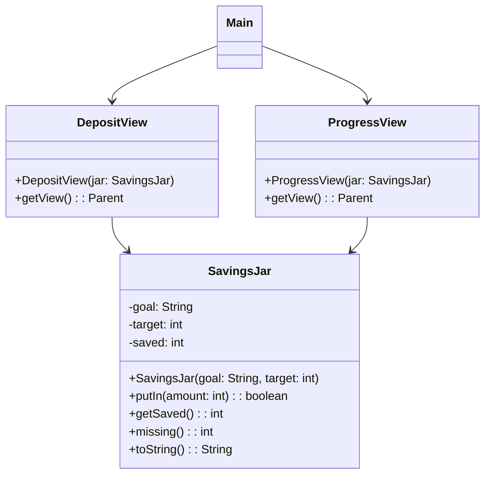

> [!info] AI-Generated

# Logic apart from the views

Step 4's ToursView kept the number of free places itself, in an instance variable of the view. That's fine while one view is all that needs it. It gets awkward when a second view needs the same data, or when you want to check the rules of the application without clicking through a window.

Module 49 moved the work of a window into a plain class that the handlers call, with no JavaFX in it. With several views, that class becomes more: it's where the application's data and rules, its **logic**, live, and every view gets the same object of it. The views only **show** what the logic says, and **forward** what the user does to it. Module 25 split text user interfaces the same way: the logic in one class, the reading and printing in another.

## The logic first

A savings jar for a goal, such as a bike for 120 euros:

**Main.java**

```java
public class Main {
    public static void main(String[] args) {
        SavingsJar jar = new SavingsJar("a bike", 120);
        System.out.println(jar.putIn(50));
        System.out.println(jar.putIn(-5));
        System.out.println(jar);
        System.out.println(jar.missing());
        jar.putIn(80);
        System.out.println(jar);
    }
}
```

**SavingsJar.java**

```java
public class SavingsJar {
    private String goal;
    private int target;
    private int saved;

    public SavingsJar(String goal, int target) {
        this.goal = goal;
        this.target = target;
    }

    public boolean putIn(int amount) {
        if (amount < 1) {
            return false;
        }
        this.saved += amount;
        return true;
    }

    public int getSaved() {
        return this.saved;
    }

    public int missing() {
        return Math.max(0, this.target - this.saved);
    }

    @Override
    public String toString() {
        if (this.missing() == 0) {
            return "Goal reached: " + this.goal + "!";
        }
        return "Saved " + this.saved + " of " + this.target + " for " + this.goal;
    }
}
```

**Output**

```text
true
false
Saved 50 of 120 for a bike
70
Goal reached: a bike!
```

This program has no window at all, and it can try every rule: a negative amount is refused, the missing amount never goes below 0, and the text changes when the goal is reached. The challenges of this step check logic classes the same way, by calling their methods.

## Two views, one jar

Now the window. The views get the jar through their constructors, and both get the **same** jar object:

**Main.java**

```java
import javafx.application.Application;
import javafx.geometry.Insets;
import javafx.scene.Scene;
import javafx.scene.control.Button;
import javafx.scene.layout.BorderPane;
import javafx.scene.layout.HBox;
import javafx.stage.Stage;

public class Main extends Application {

    @Override
    public void start(Stage stage) {
        SavingsJar jar = new SavingsJar("a bike", 120);
        DepositView deposit = new DepositView(jar);
        ProgressView progress = new ProgressView(jar);

        Button toDeposit = new Button("Deposit");
        Button toProgress = new Button("Progress");
        HBox menu = new HBox(10, toDeposit, toProgress);
        menu.setPadding(new Insets(10));

        BorderPane frame = new BorderPane();
        frame.setTop(menu);
        frame.setCenter(deposit.getView());
        toDeposit.setOnAction(event -> frame.setCenter(deposit.getView()));
        toProgress.setOnAction(event -> frame.setCenter(progress.getView()));

        stage.setScene(new Scene(frame));
        stage.setTitle("Savings jar");
        stage.show();
    }

    public static void main(String[] args) {
        launch(Main.class);
    }
}
```

**DepositView.java**

```java
import javafx.geometry.Insets;
import javafx.scene.Parent;
import javafx.scene.control.Button;
import javafx.scene.control.Label;
import javafx.scene.control.TextField;
import javafx.scene.layout.VBox;

public class DepositView {
    private SavingsJar jar;
    private VBox view;

    public DepositView(SavingsJar jar) {
        this.jar = jar;
        TextField amount = new TextField();
        amount.setPromptText("Euros");
        Button putIn = new Button("Put in");
        Label message = new Label("");
        putIn.setOnAction(event -> {
            try {
                if (this.jar.putIn(Integer.valueOf(amount.getText()))) {
                    message.setText("Thanks! " + this.jar.getSaved() + " euros saved so far.");
                    amount.clear();
                } else {
                    message.setText("Put in at least 1 euro.");
                }
            } catch (NumberFormatException e) {
                message.setText("Type a whole number of euros.");
            }
        });
        this.view = new VBox(8, amount, putIn, message);
        this.view.setPadding(new Insets(10));
    }

    public Parent getView() {
        return this.view;
    }
}
```

**ProgressView.java**

```java
import javafx.geometry.Insets;
import javafx.scene.Parent;
import javafx.scene.control.Label;
import javafx.scene.layout.VBox;

public class ProgressView {
    private SavingsJar jar;

    public ProgressView(SavingsJar jar) {
        this.jar = jar;
    }

    public Parent getView() {
        VBox view = new VBox(8, new Label(this.jar.toString()), new Label("Still missing: " + this.jar.missing() + " euros"));
        view.setPadding(new Insets(10));
        return view;
    }
}
```

**SavingsJar.java**

```java
public class SavingsJar {
    private String goal;
    private int target;
    private int saved;

    public SavingsJar(String goal, int target) {
        this.goal = goal;
        this.target = target;
    }

    public boolean putIn(int amount) {
        if (amount < 1) {
            return false;
        }
        this.saved += amount;
        return true;
    }

    public int getSaved() {
        return this.saved;
    }

    public int missing() {
        return Math.max(0, this.target - this.saved);
    }

    @Override
    public String toString() {
        if (this.missing() == 0) {
            return "Goal reached: " + this.goal + "!";
        }
        return "Saved " + this.saved + " of " + this.target + " for " + this.goal;
    }
}
```

```text
type TextField 1 "50"
click Button "Put in"
type TextField 1 "15"
click Button "Put in"
click Button "Progress"
```

Here's who does what:



- **SavingsJar** holds the data and the rules: how much is saved, that an amount must be at least 1, when the goal is reached, and how the progress reads.
- **DepositView** turns what the user typed into a number (a question of the user interface: a text field holds text), forwards it to `putIn`, and shows a message from the answer. It doesn't decide which amounts are allowed: the jar does.
- **ProgressView** only shows what the jar says. It builds a new VBox at each call of `getView()`, so each visit reads the jar again and shows the latest amounts. That's step 4's first way to build a view, and here it's the right one: the data that lasts is in the jar, not in the view.
- **Main** creates the jar and the views, gives each view the jar, and switches between them.

Since both views refer to the same SavingsJar object, a deposit made in one view is what the other one shows. Had each view made a jar of its own, Progress would always say 0.

The split pays off in other ways too. A rule changes in one place: if the jar should refuse amounts over 500, only `putIn` changes, and every view follows. A new view, such as a list of deposits, needs no change in the views that exist. And the rules can be checked without a window, as the program at the top of the step did.

---

Source: [Logic apart from the views](https://javaarena.com/learn/gui-views/logic-and-views/) in the module [GUI: multiple views](https://javaarena.com/learn/gui-views/) on Java Arena.

This module follows sections [13.5 Multiple views](https://java-programming.mooc.fi/part-13/5-multiple-views), [13.6 Summary](https://java-programming.mooc.fi/part-13/6-summary) of [Java Programming](https://java-programming.mooc.fi) by Arto Hellas, Matti Luukkainen and contributors (Agile Education Research group, University of Helsinki), licensed under [CC BY-NC-SA 4.0](https://creativecommons.org/licenses/by-nc-sa/4.0/). The explanations and exercises here are written for Java Arena and shared under the same license. Java Arena is not affiliated with or endorsed by the University of Helsinki.
