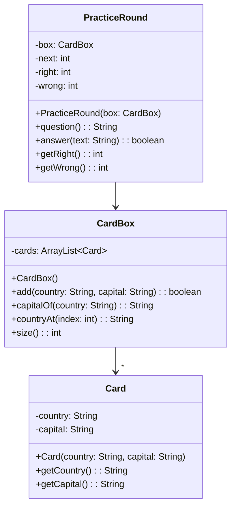

> [!info] AI-Generated

# A practice app, part 1: the logic

This step and the next build a larger application, in the way step 5 described: the logic first, in classes that know nothing about windows, and then the views on top of them.

## What the app does

The app trains the capitals of countries, with cards:

- The user **adds cards**: a country and its capital, such as Peru and Lima.
- The user **trains**: the app shows a country, the user types its capital, and the app says whether that was right and goes on to the next card. It counts the right and the wrong answers.
- The cards come in the order they were added, and after the last one the first one comes again.

A real trainer might shuffle the cards with Random (module 46). A fixed order keeps every run the same, which makes the app easy to check, and shuffling can be added later in one place: the logic.

## Three classes

The logic has two jobs, so it gets two main classes. A **CardBox** stores the cards, each a small **Card** object with a country and its capital. A **PracticeRound** runs the training: whose turn it is, and the counts.



The window will use only some of these: the view for adding cards calls `add` and `size`, and the training view calls `question`, `answer`, the getters, and `capitalOf` for its feedback. Deciding what the logic offers before any window exists is the point of starting with it.

## The card box

**Main.java**

```java
public class Main {
    public static void main(String[] args) {
        CardBox box = new CardBox();
        System.out.println(box.add("Peru", "Lima"));
        System.out.println(box.add("Kenya", " Nairobi "));
        System.out.println(box.add("Peru", "Cusco"));
        System.out.println(box.add(" ", "Oslo"));
        System.out.println(box.size() + " cards, the first is " + box.countryAt(0));
        System.out.println(box.capitalOf("Kenya") + " " + box.capitalOf("Chile"));
    }
}
```

**CardBox.java**

```java
import java.util.ArrayList;

public class CardBox {
    private ArrayList<Card> cards;

    public CardBox() {
        this.cards = new ArrayList<>();
    }

    public boolean add(String country, String capital) {
        String name = country.trim();
        String city = capital.trim();
        if (name.isEmpty() || city.isEmpty() || this.capitalOf(name) != null) {
            return false;
        }
        this.cards.add(new Card(name, city));
        return true;
    }

    public String capitalOf(String country) {
        for (Card card : this.cards) {
            if (card.getCountry().equals(country)) {
                return card.getCapital();
            }
        }
        return null;
    }

    public String countryAt(int index) {
        return this.cards.get(index).getCountry();
    }

    public int size() {
        return this.cards.size();
    }
}
```

**Card.java**

```java
public class Card {
    private String country;
    private String capital;

    public Card(String country, String capital) {
        this.country = country;
        this.capital = capital;
    }

    public String getCountry() {
        return this.country;
    }

    public String getCapital() {
        return this.capital;
    }
}
```

**Output**

```text
true
true
false
false
2 cards, the first is Peru
Nairobi null
```

- The box keeps its cards in one ArrayList of Card objects, so they stay in the order they were added, and `countryAt` gives a card's country by its place in that order. A HashMap from country to capital would find a capital faster, but its order is its own (module 31), so the training would jump around.
- `capitalOf` walks through the cards and returns the capital of the first card with that country, or `null` when no card has it, as `HashMap`'s `get` would. `add` uses it to find out whether a country is in the box already.
- `add` refuses a card with an empty country or capital, and a country that is in the box already, and returns `false` for them. The view will turn that `false` into a message, but the rule itself lives here.
- The texts are trimmed before they're stored, so `" Nairobi "` becomes `Nairobi`.

## The practice round

A PracticeRound gets the box in its constructor, the way step 5's views got the jar. It keeps `next`, the index of the card whose turn it is. It starts at 0, and each answer moves it on by one; after the last card it goes back to 0. Since the round asks the box each time, cards added during the training simply join it.

---

Source: [A practice app, part 1: the logic](https://javaarena.com/learn/gui-views/practice-app-logic/) in the module [GUI: multiple views](https://javaarena.com/learn/gui-views/) on Java Arena.

This module follows sections [13.5 Multiple views](https://java-programming.mooc.fi/part-13/5-multiple-views), [13.6 Summary](https://java-programming.mooc.fi/part-13/6-summary) of [Java Programming](https://java-programming.mooc.fi) by Arto Hellas, Matti Luukkainen and contributors (Agile Education Research group, University of Helsinki), licensed under [CC BY-NC-SA 4.0](https://creativecommons.org/licenses/by-nc-sa/4.0/). The explanations and exercises here are written for Java Arena and shared under the same license. Java Arena is not affiliated with or endorsed by the University of Helsinki.
