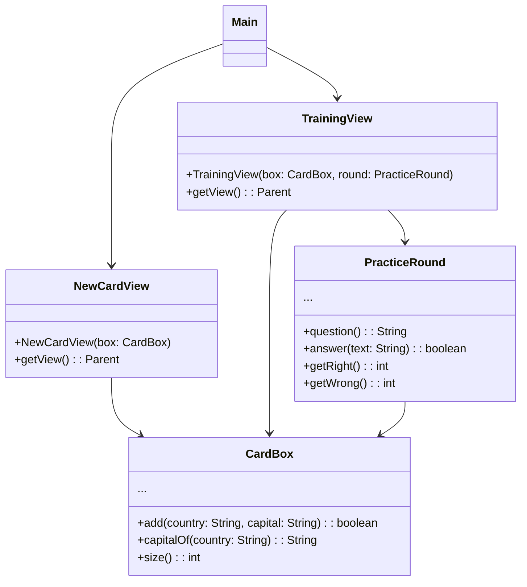

> [!info] AI-Generated

# A practice app, part 2: the views

Step 6 wrote the capitals trainer's logic: a `CardBox` that stores the cards, and a `PracticeRound` that runs the training and remembers the missed countries. Neither knows that a window exists. This step puts views on top of them.

## The plan for the window

- A BorderPane, with a menu in the top region: an HBox with the buttons `Add cards` and `Train`. The center shows one of two views, each a class with a `getView()` method (step 4).
- **NewCardView** has a field for the country, one for the capital, the button `Add card` and a label for messages. It's made once, in its constructor, so that what the user typed stays when they visit the training and come back.
- **TrainingView** shows a country, a field for the answer, the button `Answer`, a label that says whether the answer was right, and the score. It builds its nodes at each call of `getView()`, since the question depends on the cards, and the user may have added some since the last visit.
- `Main` makes one CardBox and one PracticeRound, and gives both views what they need of them.



## A first version, with a stand-in

A larger program is easier to build in pieces that each run. The first version has the real NewCardView and a **stand-in** for TrainingView: a class with the right constructor and `getView()`, which only shows a label for now. Everything compiles, the menu works, and the adding of cards can be tried before the training view exists:

**Main.java**

```java
import javafx.application.Application;
import javafx.geometry.Insets;
import javafx.scene.Scene;
import javafx.scene.control.Button;
import javafx.scene.layout.BorderPane;
import javafx.scene.layout.HBox;
import javafx.stage.Stage;

public class Main extends Application {

    @Override
    public void start(Stage stage) {
        CardBox box = new CardBox();
        PracticeRound round = new PracticeRound(box);
        NewCardView newCards = new NewCardView(box);
        TrainingView training = new TrainingView(box, round);

        Button toNewCards = new Button("Add cards");
        Button toTraining = new Button("Train");
        HBox menu = new HBox(10, toNewCards, toTraining);
        menu.setPadding(new Insets(10));

        BorderPane frame = new BorderPane();
        frame.setTop(menu);
        frame.setCenter(newCards.getView());
        toNewCards.setOnAction(event -> frame.setCenter(newCards.getView()));
        toTraining.setOnAction(event -> frame.setCenter(training.getView()));

        stage.setScene(new Scene(frame));
        stage.setTitle("Capitals");
        stage.show();
    }

    public static void main(String[] args) {
        launch(Main.class);
    }
}
```

**NewCardView.java**

```java
import javafx.geometry.Insets;
import javafx.scene.Parent;
import javafx.scene.control.Button;
import javafx.scene.control.Label;
import javafx.scene.control.TextField;
import javafx.scene.layout.VBox;

public class NewCardView {
    private CardBox box;
    private VBox view;

    public NewCardView(CardBox box) {
        this.box = box;
        TextField country = new TextField();
        country.setPromptText("Country");
        TextField capital = new TextField();
        capital.setPromptText("Capital");
        Button add = new Button("Add card");
        Label message = new Label("");
        add.setOnAction(event -> {
            if (this.box.add(country.getText(), capital.getText())) {
                message.setText("Added. Cards in the box: " + this.box.size());
                country.clear();
                capital.clear();
            } else {
                message.setText("Fill in both fields, and add each country once.");
            }
        });
        this.view = new VBox(8, country, capital, add, message);
        this.view.setPadding(new Insets(10));
    }

    public Parent getView() {
        return this.view;
    }
}
```

**TrainingView.java**

```java
import javafx.geometry.Insets;
import javafx.scene.Parent;
import javafx.scene.control.Label;
import javafx.scene.layout.VBox;

public class TrainingView {
    private CardBox box;
    private PracticeRound round;

    public TrainingView(CardBox box, PracticeRound round) {
        this.box = box;
        this.round = round;
    }

    public Parent getView() {
        VBox view = new VBox(8, new Label("Training comes in the next version."));
        view.setPadding(new Insets(10));
        return view;
    }
}
```

**CardBox.java**

```java
import java.util.ArrayList;

public class CardBox {
    private ArrayList<Card> cards;

    public CardBox() {
        this.cards = new ArrayList<>();
    }

    public boolean add(String country, String capital) {
        String name = country.trim();
        String city = capital.trim();
        if (name.isEmpty() || city.isEmpty() || this.capitalOf(name) != null) {
            return false;
        }
        this.cards.add(new Card(name, city));
        return true;
    }

    public String capitalOf(String country) {
        for (Card card : this.cards) {
            if (card.getCountry().equals(country)) {
                return card.getCapital();
            }
        }
        return null;
    }

    public String countryAt(int index) {
        return this.cards.get(index).getCountry();
    }

    public int size() {
        return this.cards.size();
    }
}
```

**Card.java**

```java
public class Card {
    private String country;
    private String capital;

    public Card(String country, String capital) {
        this.country = country;
        this.capital = capital;
    }

    public String getCountry() {
        return this.country;
    }

    public String getCapital() {
        return this.capital;
    }
}
```

**PracticeRound.java**

```java
import java.util.ArrayList;

public class PracticeRound {
    private CardBox box;
    private int next;
    private int right;
    private int wrong;
    private ArrayList<String> missed;

    public PracticeRound(CardBox box) {
        this.box = box;
        this.missed = new ArrayList<>();
    }

    public String question() {
        if (this.box.size() == 0) {
            return null;
        }
        return this.box.countryAt(this.next);
    }

    public boolean answer(String text) {
        String country = this.question();
        if (country == null) {
            return false;
        }
        boolean correct = text.trim().equalsIgnoreCase(this.box.capitalOf(country));
        if (correct) {
            this.right++;
        } else {
            this.wrong++;
            if (!this.missed.contains(country)) {
                this.missed.add(country);
            }
        }
        this.next++;
        if (this.next >= this.box.size()) {
            this.next = 0;
        }
        return correct;
    }

    public int getRight() {
        return this.right;
    }

    public int getWrong() {
        return this.wrong;
    }

    public ArrayList<String> missed() {
        return this.missed;
    }
}
```

```text
type TextField 1 "Peru"
type TextField 2 "Lima"
click Button "Add card"
type TextField 1 "Kenya"
click Button "Add card"
```

- NewCardView's handler forwards both texts to `box.add` and lets the box decide. On `true` it says how many cards there are and empties the fields for the next card; on `false` it explains what the box refuses. The rule itself stays in CardBox.
- Kenya wasn't added, since its capital was missing, and the field still holds `Kenya`, so the user only needs to type the capital.
- The stand-in TrainingView already takes the box and the round, as the real one will, so `Main` won't need to change when it's replaced.

## The training view

TrainingView's `getView()` builds a new VBox at each call. When the box is empty, there is nothing to train, and the view holds only a label that says so. Otherwise it holds the question, the answer field, the Answer button, the feedback label and the score.

Answer's handler must be careful about order. `round.answer(...)` moves the turn on to the next card, so the country that was asked, and its capital for the feedback, have to be read **before** calling it. After it, the question label shows the next country, the field is emptied for the next answer, and the score is updated.

---

Source: [A practice app, part 2: the views](https://javaarena.com/learn/gui-views/practice-app-views/) in the module [GUI: multiple views](https://javaarena.com/learn/gui-views/) on Java Arena.

This module follows sections [13.5 Multiple views](https://java-programming.mooc.fi/part-13/5-multiple-views), [13.6 Summary](https://java-programming.mooc.fi/part-13/6-summary) of [Java Programming](https://java-programming.mooc.fi) by Arto Hellas, Matti Luukkainen and contributors (Agile Education Research group, University of Helsinki), licensed under [CC BY-NC-SA 4.0](https://creativecommons.org/licenses/by-nc-sa/4.0/). The explanations and exercises here are written for Java Arena and shared under the same license. Java Arena is not affiliated with or endorsed by the University of Helsinki.
