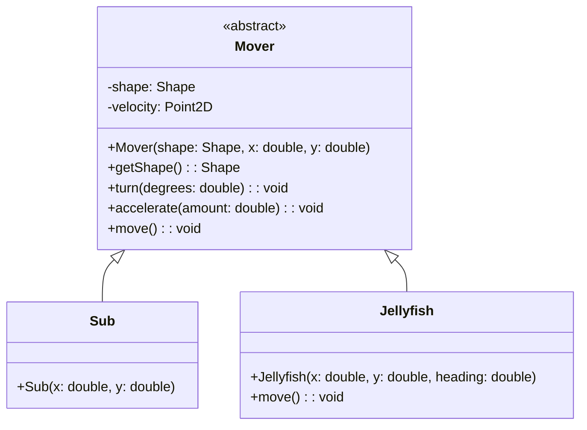

> [!info] AI-Generated

# Submarine and jellyfish share a class

The sea needs jellyfish, and they move too: each drifts slowly in its own direction and spins a little as it goes. A jellyfish needs a shape, a velocity, turning, speeding up and moving, everything the submarine has. Instead of writing all of it twice, this step puts it in one **abstract class**, as in module 34 and the modules after it: the submarine and the jellyfish both **extend** it.

## The class Mover



- A `Mover` holds a **Shape**: the class `Shape` (from `javafx.scene.shape`) is what Polygon, Circle and Rectangle all extend, so a Mover can be a polygon (the submarine, a jellyfish) or a circle (the bubbles of step 7).
- Its constructor gets the shape and where to put it, and the velocity starts at (0, 0).
- `turn(degrees)` adds to the shape's rotate, `accelerate(amount)` pushes the velocity in the direction of the rotate (the code of step 3, with the amount as a parameter), and `move()` adds the velocity to the translate.
- `getShape()` gives the shape to whoever adds it to the pane.
- Mover is **abstract**: `new Mover(...)` doesn't compile. Only its subclasses are made, and each one decides what its shape looks like.

**Main.java**

```java
import java.util.ArrayList;
import java.util.HashMap;
import java.util.List;
import java.util.Map;
import javafx.animation.AnimationTimer;
import javafx.application.Application;
import javafx.scene.Scene;
import javafx.scene.input.KeyCode;
import javafx.scene.layout.Pane;
import javafx.scene.paint.Color;
import javafx.scene.shape.Rectangle;
import javafx.stage.Stage;

public class Main extends Application {
    private Map<KeyCode, Boolean> held = new HashMap<>();

    @Override
    public void start(Stage stage) {
        Pane pane = new Pane();
        pane.setPrefSize(360, 240);
        pane.getChildren().add(new Rectangle(360, 240, Color.MIDNIGHTBLUE));

        Sub sub = new Sub(60, 120);
        pane.getChildren().add(sub.getShape());
        List<Jellyfish> jellyfish = new ArrayList<>();
        jellyfish.add(new Jellyfish(250, 60, 120));
        jellyfish.add(new Jellyfish(300, 200, 200));
        jellyfish.forEach(j -> pane.getChildren().add(j.getShape()));

        Scene scene = new Scene(pane);
        scene.setOnKeyPressed(event -> held.put(event.getCode(), true));
        scene.setOnKeyReleased(event -> held.put(event.getCode(), false));

        new AnimationTimer() {
            @Override
            public void handle(long now) {
                if (held.getOrDefault(KeyCode.LEFT, false)) {
                    sub.turn(-4);
                }
                if (held.getOrDefault(KeyCode.RIGHT, false)) {
                    sub.turn(4);
                }
                if (held.getOrDefault(KeyCode.UP, false)) {
                    sub.accelerate(0.125);
                }
                sub.move();
                jellyfish.forEach(j -> j.move());
            }
        }.start();

        stage.setScene(scene);
        stage.setTitle("Deep dive");
        stage.show();
    }

    public static void main(String[] args) {
        launch(Main.class);
    }
}
```

**Mover.java**

```java
import javafx.geometry.Point2D;
import javafx.scene.shape.Shape;

public abstract class Mover {
    private Shape shape;
    private Point2D velocity;

    public Mover(Shape shape, double x, double y) {
        this.shape = shape;
        this.shape.setTranslateX(x);
        this.shape.setTranslateY(y);
        this.velocity = new Point2D(0, 0);
    }

    public Shape getShape() {
        return shape;
    }

    public void turn(double degrees) {
        shape.setRotate(shape.getRotate() + degrees);
    }

    public void accelerate(double amount) {
        double angle = Math.toRadians(shape.getRotate());
        velocity = velocity.add(Math.cos(angle) * amount, Math.sin(angle) * amount);
    }

    public void move() {
        shape.setTranslateX(shape.getTranslateX() + velocity.getX());
        shape.setTranslateY(shape.getTranslateY() + velocity.getY());
    }
}
```

**Sub.java**

```java
import javafx.scene.paint.Color;
import javafx.scene.shape.Polygon;

public class Sub extends Mover {

    public Sub(double x, double y) {
        super(new Polygon(-15, -6, 9, -6, 15, 0, 9, 6, -15, 6), x, y);
        getShape().setFill(Color.GOLD);
    }
}
```

**Jellyfish.java**

```java
import javafx.scene.paint.Color;
import javafx.scene.shape.Polygon;

public class Jellyfish extends Mover {

    public Jellyfish(double x, double y, double heading) {
        super(new Polygon(-10, 0, -6, -8, 0, -10, 6, -8, 10, 0, 7, 10, 3, 2, 0, 10, -3, 2, -7, 10), x, y);
        getShape().setFill(Color.ORCHID);
        turn(heading);
        accelerate(0.5);
    }

    @Override
    public void move() {
        super.move();
        turn(1);
    }
}
```

```text
press key UP
frames 10
release key UP
frames 60
```

- `Sub`'s constructor calls `super(...)` with a new Polygon: the call to the parent's constructor must come first in a constructor, so the shape is made right inside it. Then it colors the shape, through `getShape()`, since `shape` is private in Mover.
- `Jellyfish`'s constructor turns the new jellyfish to its heading and gives it a speed of 0.5 pixels a frame that way, once. It never speeds up again, so it drifts in a straight line.
- `Jellyfish` **overrides** `move()`: `super.move()` runs Mover's own `move` (the drifting), and then the jellyfish turns 1 degree. So it spins slowly as it drifts. Turning doesn't change its direction of travel: that was set once, by `accelerate` in the constructor. The submarine doesn't override `move`, so it uses Mover's.
- `Main` got shorter: the key handlers call `sub.turn(-4)`, `sub.turn(4)` and `sub.accelerate(0.125)`, and each frame moves the submarine and every jellyfish. `jellyfish.forEach(j -> j.move())` calls `move` on each one, as a for-each loop would.

The first jellyfish starts at (250, 60) heading 120 degrees, down and to the left; after 70 frames it has moved 35 pixels that way and turned 70 degrees. In the animation, each jellyfish spins a little in every frame while it drifts along its velocity.

---

Source: [Submarine and jellyfish share a class](https://javaarena.com/learn/asteroids/movers/) in the module [Project: an Asteroids-style game](https://javaarena.com/learn/asteroids/) on Java Arena.

This module follows section [14.3 Larger application: Asteroids](https://java-programming.mooc.fi/part-14/3-larger-application-asteroids) of [Java Programming](https://java-programming.mooc.fi) by Arto Hellas, Matti Luukkainen and contributors (Agile Education Research group, University of Helsinki), licensed under [CC BY-NC-SA 4.0](https://creativecommons.org/licenses/by-nc-sa/4.0/). The explanations and exercises here are written for Java Arena and shared under the same license. Java Arena is not affiliated with or endorsed by the University of Helsinki.
