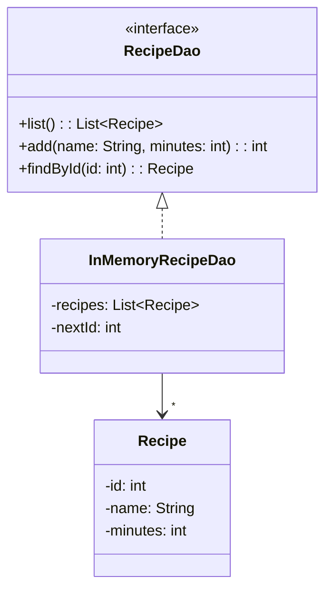

> [!info] AI-Generated

# Data access objects

A program that keeps data for longer than one run stores it somewhere: in files (module 43), in a database (step 4), or on a server somewhere else. Where it's stored is a decision that can change. A shop's program might start with a file, move to a database when it grows, and use a list in memory in its tests.

If code all over the program reads and writes the file itself, each such change means changing all of that code. A **data access object**, a **DAO** for short, puts everything about storing in one class. The rest of the program asks it for the data and hands it new data, and never knows where the data lives. It's the same idea as module 25's split between the user interface and the program's logic, one layer further down.

## The interface

A DAO is usually described by an interface (module 35): the things it can do, with no word about how. A recipe box keeps recipes:

```java
public interface RecipeDao {
    List<Recipe> list();
    int add(String name, int minutes);
    Recipe findById(int id);
}
```

- `list()` returns every recipe.
- `add(name, minutes)` stores a new recipe and returns the **id** it got: a number that names this recipe and no other.
- `findById(id)` returns the recipe with that id, or `null` when there's none.

Why ids? Two recipes can have the same name, and a name can change. A table usually has an id column whose numbers the database hands out, and the rest of the program uses that number to say which one it means: "show recipe 3", "remove recipe 5". The DAO hands out the ids, never the caller.

## An implementation that keeps everything in memory

The simplest DAO keeps its recipes in a list. Its data is gone when the program ends, but everything else works as with a real database, which makes it right for trying a program out and for tests:

**Main.java**

```java
public class Main {
    public static void main(String[] args) {
        RecipeDao recipes = new InMemoryRecipeDao();
        int curry = recipes.add("Chickpea curry", 40);
        recipes.add("Herb flatbread", 20);
        System.out.println("The curry got id " + curry);
        System.out.println(recipes.list());
        System.out.println(recipes.findById(2));
        System.out.println(recipes.findById(7));
    }
}
```

**RecipeDao.java**

```java
import java.util.List;

public interface RecipeDao {
    List<Recipe> list();
    int add(String name, int minutes);
    Recipe findById(int id);
}
```

**InMemoryRecipeDao.java**

```java
import java.util.ArrayList;
import java.util.List;

public class InMemoryRecipeDao implements RecipeDao {
    private List<Recipe> recipes;
    private int nextId;

    public InMemoryRecipeDao() {
        this.recipes = new ArrayList<>();
        this.nextId = 1;
    }

    @Override
    public List<Recipe> list() {
        return new ArrayList<>(this.recipes);
    }

    @Override
    public int add(String name, int minutes) {
        int id = this.nextId;
        this.nextId++;
        this.recipes.add(new Recipe(id, name, minutes));
        return id;
    }

    @Override
    public Recipe findById(int id) {
        for (Recipe recipe : this.recipes) {
            if (recipe.getId() == id) {
                return recipe;
            }
        }
        return null;
    }
}
```

**Recipe.java**

```java
public class Recipe {
    private int id;
    private String name;
    private int minutes;

    public Recipe(int id, String name, int minutes) {
        this.id = id;
        this.name = name;
        this.minutes = minutes;
    }

    public int getId() {
        return this.id;
    }

    public String getName() {
        return this.name;
    }

    public int getMinutes() {
        return this.minutes;
    }

    @Override
    public String toString() {
        return "#" + this.id + " " + this.name + ", " + this.minutes + " min";
    }
}
```

**Output**

```text
The curry got id 1
[#1 Chickpea curry, 40 min, #2 Herb flatbread, 20 min]
#2 Herb flatbread, 20 min
null
```



- **Ids grow from 1.** `nextId` is the id the next recipe gets. `add` takes it and counts it up, so every recipe gets a new one. A database table with an identity column, like the one in step 4, does the same: H2 doesn't hand out a removed row's id again, even after the program restarts. That matters because an old "recipe 5" written down somewhere must never come to mean another recipe.
- **`list()` returns a new list** with the same recipes. If it returned `this.recipes` itself, a caller could `clear()` it, or add a recipe with any id it likes, past the DAO. A database's DAO also builds a new list for every call, so a caller can't tell the difference.
- **`main` uses the interface.** The variable's type is `RecipeDao`; only the line with `new` names the class. Swap that one line for another DAO, and the rest of the program stays the same.

## Changing and removing

A DAO usually does two more things:

```java
boolean update(Recipe recipe);
boolean remove(int id);
```

`update` stores the recipe it's given in place of the one with the same id, and `remove` removes the one with that id. Both return whether there was such a recipe. Together with `add` and the two ways of reading, these are often called **CRUD**: create, read, update and delete, the four things a program does with stored data.

---

Source: [Data access objects](https://javaarena.com/learn/libraries-and-tools/data-access-objects/) in the module [Libraries, Maven and databases](https://javaarena.com/learn/libraries-and-tools/) on Java Arena.

This module follows sections [14.4 Maven and third-party libraries](https://java-programming.mooc.fi/part-14/4-maven-and-third-party-libraries), [14.5 Conclusion](https://java-programming.mooc.fi/part-14/5-conclusion) of [Java Programming](https://java-programming.mooc.fi) by Arto Hellas, Matti Luukkainen and contributors (Agile Education Research group, University of Helsinki), licensed under [CC BY-NC-SA 4.0](https://creativecommons.org/licenses/by-nc-sa/4.0/). The explanations and exercises here are written for Java Arena and shared under the same license. Java Arena is not affiliated with or endorsed by the University of Helsinki.
