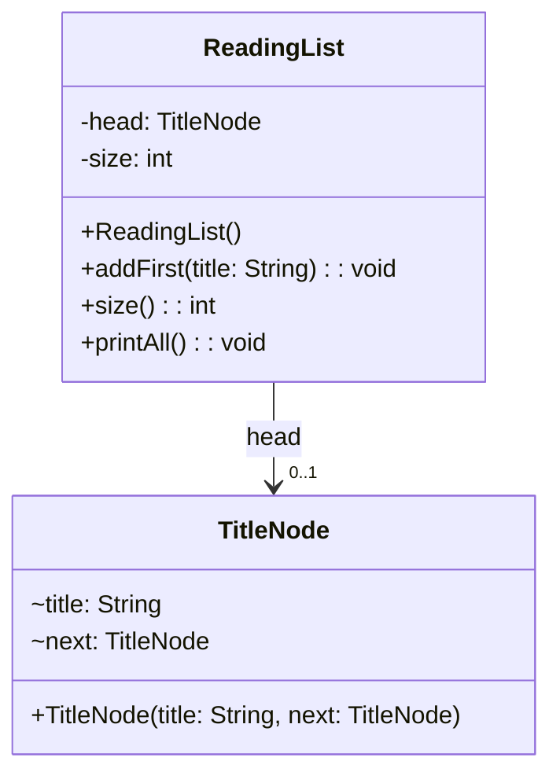

> [!info] AI-Generated

# A linked list class

Step 1 changed the links by hand in `main`, where one wrong assignment cuts off the rest of the chain. A list class keeps its nodes to itself: the code that uses it calls methods such as `addFirst`, and never sees a node. Here's a reading list of book titles, with the newest wish at the front:

**Main.java**

```java
public class Main {
    public static void main(String[] args) {
        ReadingList list = new ReadingList();
        list.addFirst("Emma");
        list.addFirst("Dune");
        list.addFirst("Beloved");
        System.out.println(list.size() + " books");
        list.printAll();
    }
}
```

**ReadingList.java**

```java
public class ReadingList {
    private TitleNode head;
    private int size;

    public ReadingList() {
        this.head = null;
        this.size = 0;
    }

    public void addFirst(String title) {
        this.head = new TitleNode(title, this.head);
        this.size++;
    }

    public int size() {
        return this.size;
    }

    public void printAll() {
        TitleNode current = this.head;
        while (current != null) {
            System.out.println(current.title);
            current = current.next;
        }
    }
}
```

**TitleNode.java**

```java
public class TitleNode {
    String title;
    TitleNode next;

    public TitleNode(String title, TitleNode next) {
        this.title = title;
        this.next = next;
    }
}
```

**Output**

```text
3 books
Beloved
Dune
Emma
```



Each TitleNode's `next` refers to another TitleNode (a diagram can't draw a class connected to itself, so it's shown as the field).

- `head` refers to the first node, or is `null` while the list is empty.
- `addFirst` makes a node whose `next` is the old first node, and then moves `head` to the new node. On an empty list, the old head is `null`, so the new node's `next` is `null`: the same line works for both.
- The list counts its values in `size`. Counting the nodes would mean walking the whole list every time.

Adding at the front takes the same few steps however long the list is. An ArrayList's `add(0, value)` has to move every value in its array one place along first (module 45).

## Adding at the end

To add at the end, the list needs its last node, so that it can set that node's `next`. Walking from `head` to the last node takes one step per node:

```java
TitleNode current = this.head;
while (current.next != null) {
    current = current.next;
}
current.next = new TitleNode(title, null);
```

This loop also crashes on an empty list, as in step 1. A list that adds at the end often keeps a second reference, `tail`, to its last node. Then adding at the end takes a few steps too: link the new node after `tail`, and move `tail` to it. Every method that changes the list must keep `tail` right. When the list is empty, `head` and `tail` are both `null`; after the first value, both refer to the same node.

## Reading and removing

- **get(index)** has no array to jump into: it starts at `head` and follows `next` index times. An ArrayList's `get` goes straight to the place in its array, so it takes the same steps for any index; a linked list's `get(1000)` follows 1,000 links.
- **removeFirst()** moves `head` to the second node, `this.head = this.head.next;`. Nothing refers to the old first node any more, so Java's garbage collector can free its memory. When the list becomes empty, `tail` must become `null` too, or it would still refer to the removed node.
- Bad input gets an exception, as in module 45: `throw new IndexOutOfBoundsException(...)` for an index outside the list.

---

Source: [A linked list class](https://javaarena.com/learn/linked-structures/a-linked-list/) in the module [Linked lists, stacks, queues and trees](https://javaarena.com/learn/linked-structures/) on Java Arena.

An extra module, not part of the University of Helsinki's course. Lesson text: [CC BY-NC-SA 4.0](https://creativecommons.org/licenses/by-nc-sa/4.0/).
